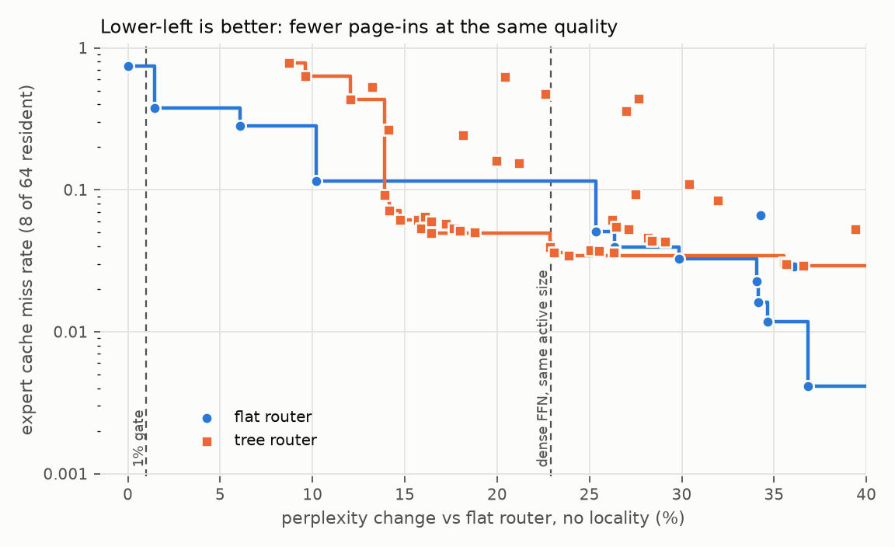

# Experts in Residence

A pre-registered test of one idea for running sparse mixture-of-experts (MoE) models on
memory-limited devices: route with a two-level tree, make the *cluster* choice sticky, and
keep the *expert* choice inside the cluster free.

**Result: the hypothesis is not supported.** The sticky cluster does make locality cheap, but
restricting a token's experts to one cluster costs 8.7% perplexity before any locality is
asked for. No tree configuration gets within 5% of the flat baseline, let alone the
pre-registered 1%.



Every point is one configuration; the lines are each family's best trade-off. Configurations
beyond +40% perplexity are off the chart.

## The problem

An MoE model only runs a few experts per token, but all of them have to be reachable. On a
phone or a laptop they do not fit in fast memory, so a few experts stay resident and the rest
are paged in on demand ([Eliseev & Mazur, 2023](https://arxiv.org/abs/2312.17238);
[survey](https://arxiv.org/abs/2412.14219)). Every page-in stalls decoding, so what matters is
how often the next token needs an expert that is not resident.

How much a router reuses experts across adjacent tokens varies a lot between models
([Mixtral](https://arxiv.org/abs/2401.04088); [Liang et al., 2026](https://arxiv.org/abs/2505.16056)).
Training the router for reuse helps ([ReMoE](https://arxiv.org/abs/2605.27081)), but a recent
pre-registered study found that every such configuration failed a 1% perplexity gate:
"miss reduction and quality are tightly coupled" ([Suram, 2026](https://arxiv.org/abs/2608.18261)).

## Hypothesis

A flat router that reuses experts has to give up per-token choice. A tree router has two
decisions, and only one of them needs to be slow:

- **cluster** (1 of 8): trained to stay put across adjacent tokens,
- **expert** (2 of the 8 in that cluster): free for every token.

With a cache of 8 experts, a token that stays in its cluster never misses.

**H1.** At equal quality (perplexity within 1% of a plain flat router), the tree family's best
cache miss rate is at most half the flat family's.

The hypothesis, model, grids and decision rule were committed in
[PREREGISTRATION.md](PREREGISTRATION.md) before any full training run. One amendment (batch
size, for memory) was made before any run finished and is recorded there.

## Results

Cache of 8 of 64 experts per layer, LRU, 48 held-out streams of 4,096 tokens. Full tables in
[results/report.md](results/report.md).

| trained model, no rerouting | perplexity | vs flat | miss @8 | miss @4 | cluster switch |
|---|---|---|---|---|---|
| flat | 53.59 | – | 0.739 | 0.856 | – |
| flat, reuse loss λ=0.03 | 54.36 | +1.4% | 0.379 | 0.573 | – |
| flat, reuse loss λ=0.1 | 67.17 | +25.4% | 0.051 | 0.108 | – |
| tree | 58.26 | +8.7% | 0.780 | 0.886 | 0.838 |
| tree, sticky cluster λ=0.1 | 61.03 | +13.9% | 0.092 | 0.460 | 0.055 |
| dense FFN, same active size | 65.85 | +22.9% | – | – | – |

Pre-registered decision, selected on even streams and reported on odd:

| gate | flat family | tree family |
|---|---|---|
| ≤1% | 0.743 (the baseline itself) | none passes |
| ≤2% | 0.385 (λ=0.03) | none passes |
| ≤5% | 0.385 (λ=0.03) | none passes |

The seed-to-seed perplexity gap of the flat baseline is 0.13%, so the 1% gate is not inside
seed noise and the verdict stands.

### What the data says

1. **The tree is the cost, not the stickiness.** Plain tree routing is 8.7% worse than plain
   flat routing, and the gap is about the same in all three domains (+8% wiki, +10% stories,
   +9% code). That entry fee is larger than anything locality could win back.
2. **Inside the tree, locality is cheap.** Relative to its own baseline, the sticky cluster
   removes 88% of misses (0.780 to 0.092) for +4.7% perplexity. The flat router pays +10% for
   84% (λ=0.03 with cache bonus 1) and +25% for 93% (λ=0.1). This is the mechanism H1 predicted;
   it just does not pay for the tree.
3. **The flat result replicates the coupling.** The only flat configuration within 1% is the
   baseline. The mildest reuse loss already costs 1.4%, in line with Suram (2026) at a much
   smaller scale.
4. **A cache smaller than a cluster breaks the tree.** With 4 resident experts the sticky tree
   misses 46% of the time against 11% for flat λ=0.1. The tree never learned to reuse experts,
   only clusters (expert switch rate 0.82), as the pre-registration's limits anticipated.
5. **Hysteresis is free only after training for it.** A margin of 2 on the sticky tree cuts
   misses from 0.092 to 0.062 for +0.8% perplexity. On the plain tree a margin of 1 costs 11%.
6. **The slow cluster gate adds nothing** over the reuse loss at the same weight (62.20
   perplexity, 0.064 misses; a different point on the same frontier).

### Exploratory, not pre-registered

Added after seeing the results:

- The tree frontier is below the flat one only between about +14% and +25% perplexity (ratio
  0.42 to 0.67). A dense model with the same active parameters sits at +22.9%, so that window is
  not a place anyone would deploy.
- Flat routers trained with λ ≥ 0.1 are *worse* than the dense model: forcing reuse on the
  64-way choice throws away the whole benefit of having experts. The sticky tree at λ=0.1 keeps
  39% of it.

## What I would try next

The stickiness worked and the structure did not, so the next step is to get the grouping
without the constraint:

- group the experts of a trained *flat* router by co-activation and apply the sticky choice to
  those groups, so the baseline perplexity is untouched;
- let a token use two clusters, with only the first one sticky;
- more seeds and longer training for the tree gap itself, which rests on one seed here.

## Setup

- 4-layer causal transformer, d=192, context 256, 4k BPE vocabulary. Every FFN is an MoE with
  64 experts (hidden 384), 2 active per token: 39M parameters, 2.6M active.
- WikiText-2, TinyStories and CPython standard library source; each sequence is one domain.
- 2,000 steps, batch 16x256, same batches for every run. 11 runs, about 11 minutes each on an M1.
- Flat family: reuse loss on the 64-way expert distribution, λ ∈ {0, 0.03, 0.1, 0.3}, cache
  bonus Δ ∈ {0, 1, 2, 4} at inference ([Skliar et al., 2024](https://arxiv.org/abs/2412.00099)).
- Tree family: reuse loss on the 8-way cluster distribution only, same λ, plus a slow cluster
  gate; cache bonus and cluster hysteresis m ∈ {0, 1, 2} at inference.
- 78 evaluated configurations in total.

Both routers share the expert bank, the balance loss and the batches. No token is ever dropped:
experts run in blocks of the mean load in a single `bmm`, whatever the load skew.

## Reproduce

```bash
python -m venv .venv && . .venv/bin/activate && pip install -r requirements.txt
python -m eir.data      # download and tokenize
./run_all.sh            # 11 training runs
python evaluate.py      # results/results.json
python report.py        # results/report.md, assets/frontier.png
pytest -q
```

| file | what |
|---|---|
| `eir/moe.py` | flat and tree routers, expert bank, LRU expert cache |
| `eir/model.py` | the language model |
| `eir/cache.py` | miss rate, coverage and switch-rate metrics from routing traces |
| `train.py`, `run_all.sh` | training |
| `evaluate.py`, `report.py` | inference grid, decision rule, plot |

## Limits

- One seed per configuration; only the flat baseline has a second seed.
- A 39M-parameter model trained for 2,000 steps. The tree's entry fee may shrink with scale or
  training time; this experiment cannot say.
- The cache model counts page-ins. It does not measure latency.
- A cache of 8 equals one cluster, which favours the tree. It still lost.

## References

1. Jiang et al. *Mixtral of Experts.* 2024. [arXiv:2401.04088](https://arxiv.org/abs/2401.04088)
2. Eliseev, Mazur. *Fast Inference of Mixture-of-Experts Language Models with Offloading.* 2023. [arXiv:2312.17238](https://arxiv.org/abs/2312.17238)
3. Liang et al. *Not All Models Suit Expert Offloading: On Local Routing Consistency of Mixture-of-Expert Models.* ICLR 2026. [arXiv:2505.16056](https://arxiv.org/abs/2505.16056)
4. Suram. *Cacheable by Design? Training Mixture-of-Experts Routers for Locality Against the Edge Memory-Bandwidth Wall: A Pre-Registered Negative Result with a Systems Measurement Study.* 2026. [arXiv:2608.18261](https://arxiv.org/abs/2608.18261)
5. *ReMoE.* 2026. [arXiv:2605.27081](https://arxiv.org/abs/2605.27081)
6. Skliar et al. *Mixture of Cache-Conditional Experts for Efficient Mobile Device Inference.* 2024. [arXiv:2412.00099](https://arxiv.org/abs/2412.00099)
7. *A Survey on Inference Optimization Techniques for Mixture of Experts Models.* 2024. [arXiv:2412.14219](https://arxiv.org/abs/2412.14219)
8. Fedus, Zoph, Shazeer. *Switch Transformers.* 2021. [arXiv:2101.03961](https://arxiv.org/abs/2101.03961)
9. Shazeer et al. *Outrageously Large Neural Networks: The Sparsely-Gated Mixture-of-Experts Layer.* 2017. [arXiv:1701.06538](https://arxiv.org/abs/1701.06538)
